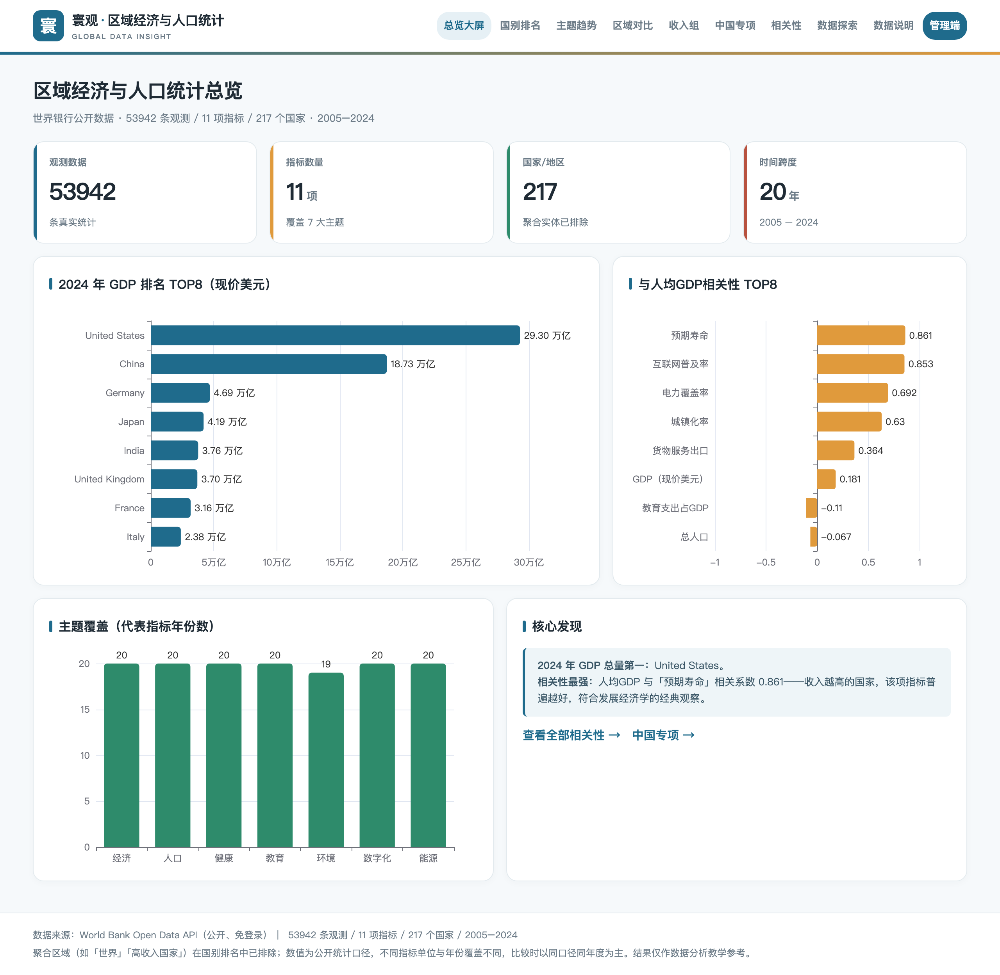
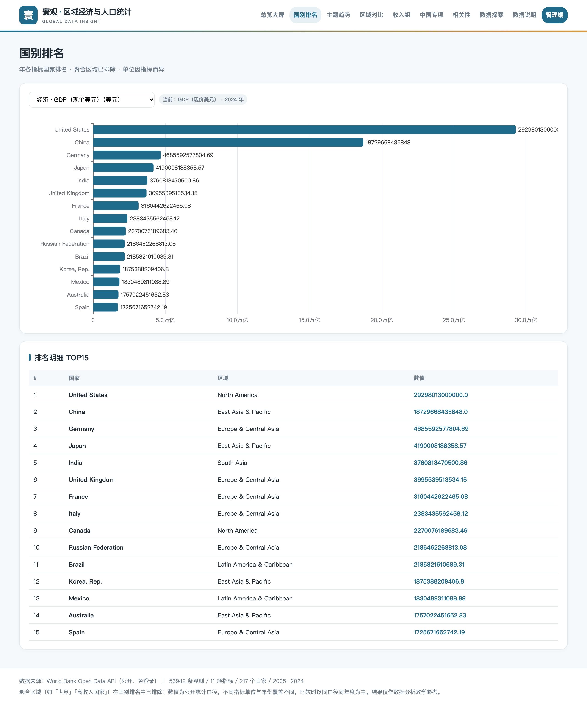
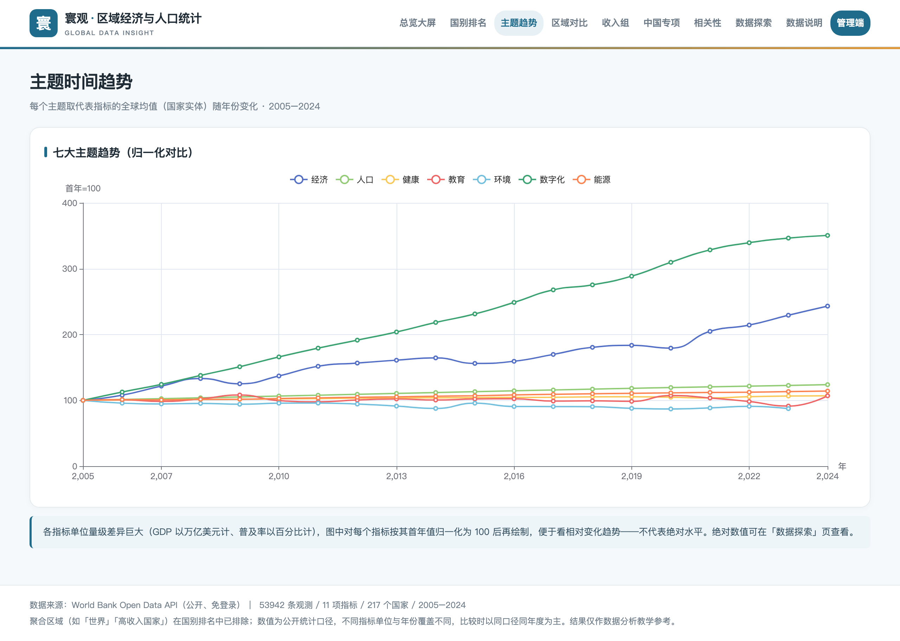
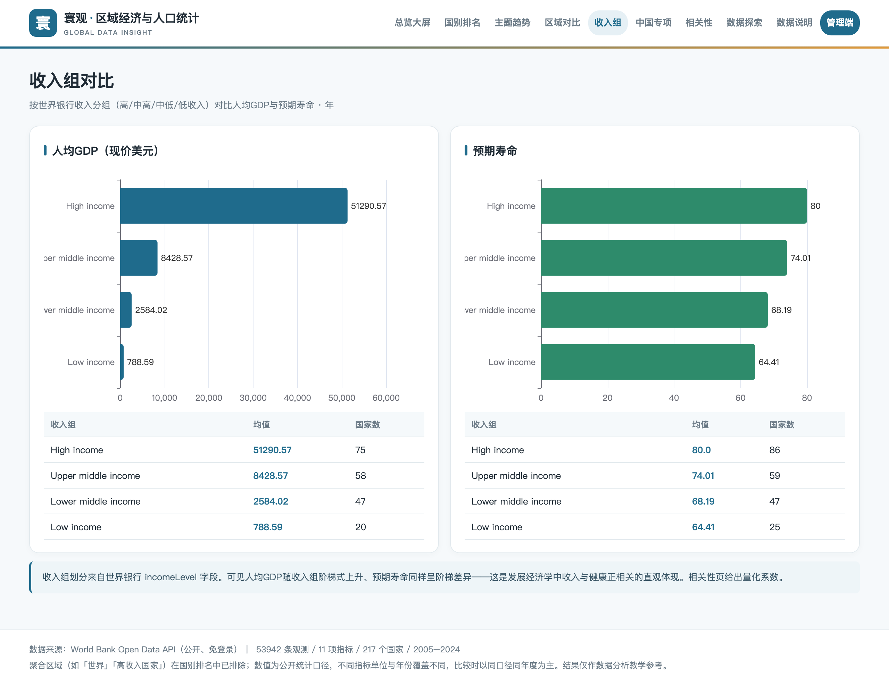
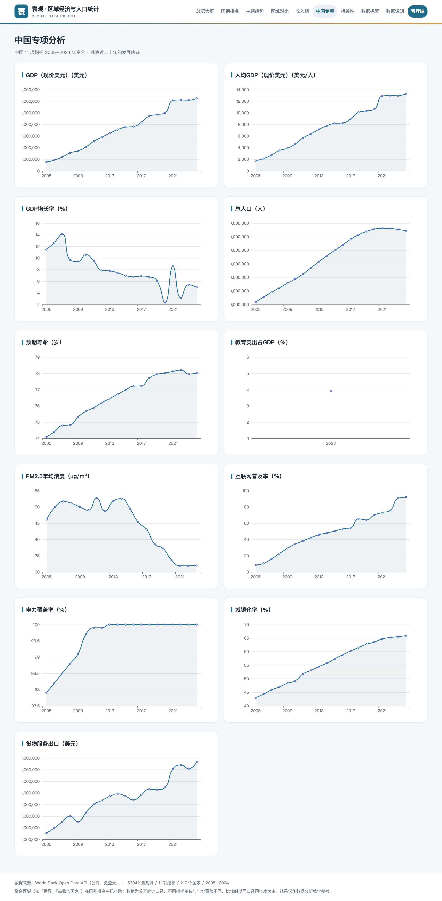
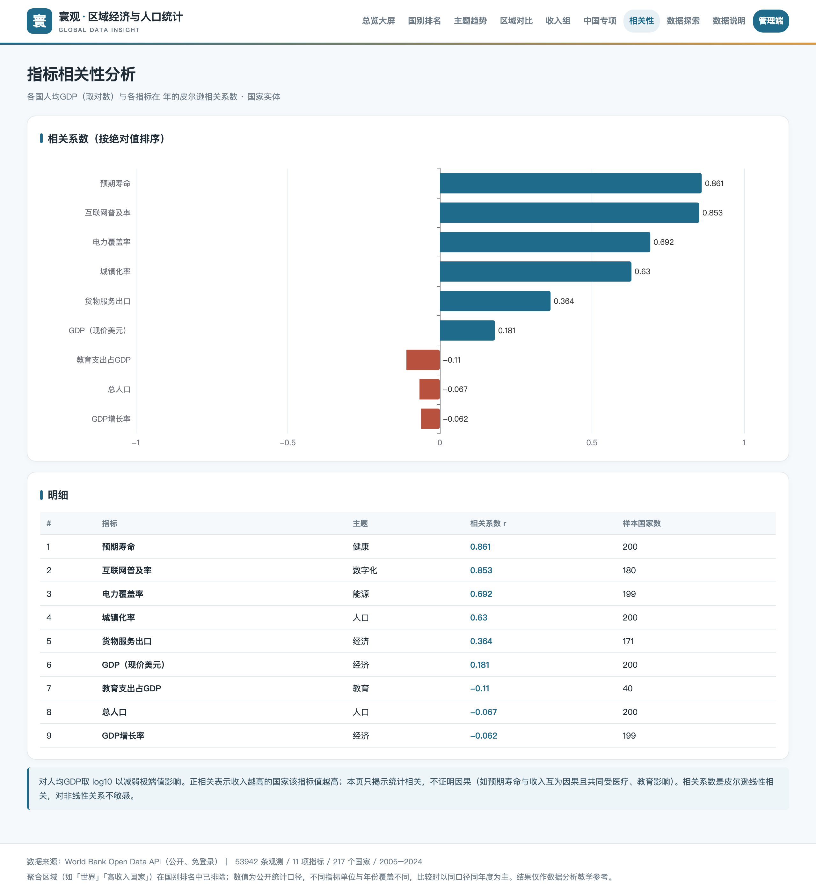

# 047 基于世界银行公开指标的区域经济与人口统计分析系统-设计展示

> **代码有偿获取 可接受定制 微信联系方式: csbysj2020 或 ACE2487，备注(BS)**

> **完整源码与全套文档 · 在线自助获取 >>> [https://mbd.pub/o/bread/YZaWmJZqZA==](https://mbd.pub/o/bread/YZaWmJZqZA==)**

> **成品页（功能介绍 / 更多选题）>>> [https://bishe.suilang.net/products/worldbank-stats](https://bishe.suilang.net/products/worldbank-stats)**

> 

> 

## 视频

> **点击查看 >>> [https://www.bilibili.com/video/BV1mQsb64ExF/](https://www.bilibili.com/video/BV1mQsb64ExF/)**

## 项目简介

真实采集 World Bank Open Data 公开指标，经济/人口/健康/教育/环境/能源/数字化七大类 11 项指标、217 个国家、20 年（2005–2024）共 53942 条观测。用国家维表权威排除聚合实体，做国别排名、主题趋势、区域/收入组对比与人均GDP相关性分析（预期寿命 r=0.861）。9 个页面含中国专项与数据探索，ECharts 本地内置离线可用。聚合实体口径、跨指标单位差异与相关不等于因果均如实标注。

公开统计数据是学习数据分析的优质素材。

本项目设计并实现了一套基于世界银行公开指标的区域经济与人口统计分析系统：通过 World Bank Open Data API 采集经济、人口、健康、教育、环境、能源、数字化七大主题共 11 项指标、覆盖 217 个国家、20 年（2005–2024）的 53942 条观测，经结构化清洗后用国家维表权威排除区域与收入组等聚合实体；从国别排名、主题趋势、区域对比、收入组对比、相关性与中国专项多维统计；用对数变换后的皮尔逊相关分析发现人均GDP与预期寿命相关性最强（r=0.861）。

系统实现总览大屏、国别排名、主题趋势、区域对比、收入组、中国专项、相关性、数据探索与数据说明共 9 个页面，ECharts 本地内置、离线可用。

本仓库为**设计展示**：包含项目说明、技术架构、实验结果与运行截图；完整源码、任务书、开题报告、毕业论文与使用说明可通过上方链接自助获取，成品页可查看更多选题，也可联系微信咨询定制。

## 功能特性

1. 真实采集：World Bank Open Data API（公开免登录），53942 条观测 / 11 指标 / 217 国家 / 20 年

2. 口径严谨：用国家维表 region=='Aggregates' 权威排除 79 个聚合实体，排名不含「世界/高收入国家」

3. 国别排名：11 项指标按最新年度切换，2024 年 GDP 第一为 United States

4. 主题趋势：七大主题代表指标按首年=100 归一化，看 20 年相对变化

5. 区域/收入组对比：各大区与高/中/低收入组在人均GDP与预期寿命上的梯度差异

6. 相关性分析：人均GDP取 log10 后与各指标的皮尔逊系数，预期寿命 r=0.861 最强；强调相关不等于因果

7. 中国专项：11 项指标 20 年变化曲线；数据探索按指标/国家检索原始观测

8. 数字单一来源：页面与论文读 data/stats.json，重跑采集→分析→入库三步即可同步

9. 诚实边界：个别指标无数据如实跳过、跨指标单位不同不外推、相关不等于因果

## 技术架构

| 项目 | 说明 |
| --- | --- |
| 编程语言 | Python 3.8 及以上 |
| Web 框架 | Django 4.2（默认 SQLite，免装数据库） |
| 统计计算 | NumPy（均值/皮尔逊相关，人均GDP取对数） |
| 前端 | Django 模板 + 本地内置 ECharts（离线可用） |
| 样本规模 | 53942 观测 / 11 指标 / 217 国家 / 20 年 |
| 运行端口 | http://127.0.0.1:8047 |
| 演示账号 | admin / admin123456 |

## 目录结构

以下为完整交付版的结构（本仓库仅作设计展示）：

```
worldbank-stats/
├── analytics/
│   ├── __init__.py
│   └── build.py
├── crawler/
│   ├── __init__.py
│   └── fetch_worldbank.py
├── data/
│   ├── analysis/
│   │   ├── china.json
│   │   ├── corr.json
│   │   ├── income_compare.json
│   │   ├── indicator_meta.json
│   │   ├── overview.json
│   │   ├── rankings.json
│   │   ├── region_compare.json
│   │   └── topic_trend.json
│   ├── processed/
│   │   ├── countries.csv
│   │   └── indicators.csv
│   ├── raw/
│   │   ├── EG.ELC.ACCS.ZS.json
│   │   ├── EN.ATM.PM25.MC.M3.json
│   │   ├── IT.NET.USER.ZS.json
│   │   ├── NE.EXP.GNFS.CD.json
│   │   ├── NY.GDP.MKTP.CD.json
│   │   ├── NY.GDP.MKTP.KD.ZG.json
│   │   ├── NY.GDP.PCAP.CD.json
│   │   ├── SE.XPD.TOTL.GD.ZS.json
│   │   ├── SP.DYN.LE00.IN.json
│   │   ├── SP.POP.TOTL.json
│   │   └── SP.URB.TOTL.IN.ZS.json
│   └── stats.json
├── globescope/
│   ├── __init__.py
│   ├── settings.py
│   ├── urls.py
│   └── wsgi.py
├── static/
│   ├── css/
│   │   └── style.css
│   ├── vendor/
│   │   └── echarts.min.js
│   └── …
└── …
```

## 数据与实验结论

- 真实采集：World Bank Open Data API（公开免登录），53942 条观测 / 11 指标 / 217 国家 / 20 年
- 口径严谨：用国家维表 region=='Aggregates' 权威排除 79 个聚合实体，排名不含「世界/高收入国家」
- 国别排名：11 项指标按最新年度切换，2024 年 GDP 第一为 United States
- 主题趋势：七大主题代表指标按首年=100 归一化，看 20 年相对变化

## 交付内容

1. 完整源码（Django 工程 + World Bank 采集器 + 多维分析引擎 + 9 个页面模板）
2. 真实数据（原始 JSON + 结构化 CSV 53942 条 + SQLite 数据库）
3. 一键启动脚本（macOS / Windows）
4. 毕业设计任务书（Word）、开题报告（Word）
5. 毕业论文（Word，七章制，含架构图与系统截图）
6. 系统使用与二次开发说明（Word + md）
7. 7 张界面截图、论文配图、封面、演示视频

## 常见问题

**数据是爬的吗？能更新吗？**

是。crawler/fetch_worldbank.py 调 World Bank Open Data API 采集，免登录无需 key。重跑采集→分析（analytics/build.py）→入库（manage.py import_wb）三步即可更新，页面与论文数字都读 stats.json 自动同步。

**为什么排名里没有「世界」「高收入国家」？**

世界银行国家列表含 79 个聚合实体（region=='Aggregates'），本项目用国家维表权威排除，避免它们挤进国家排名导致失真。

**相关性高说明有因果吗？**

不说明。人均GDP与预期寿命高相关（r=0.861），但二者互为因果且共同受医疗教育影响。页面与论文都强调「相关不等于因果」。

**不同指标能直接比大小吗？**

不能。GDP 以万亿美元计、普及率以百分比计，单位不同。趋势页用「首年=100」归一化便于看相对变化，绝对值到数据探索页查看。

**为什么有的指标没有数据？**

人均CO2排放接口本次未返回数据，已如实跳过不编造；其它指标部分年份有缺失属正常统计口径。

**能换 MySQL 吗？**

能。设 DB_ENGINE=mysql 及 DB_NAME/DB_USER/DB_PASSWORD 后 migrate 即可，默认 SQLite 免安装。

## 截图








